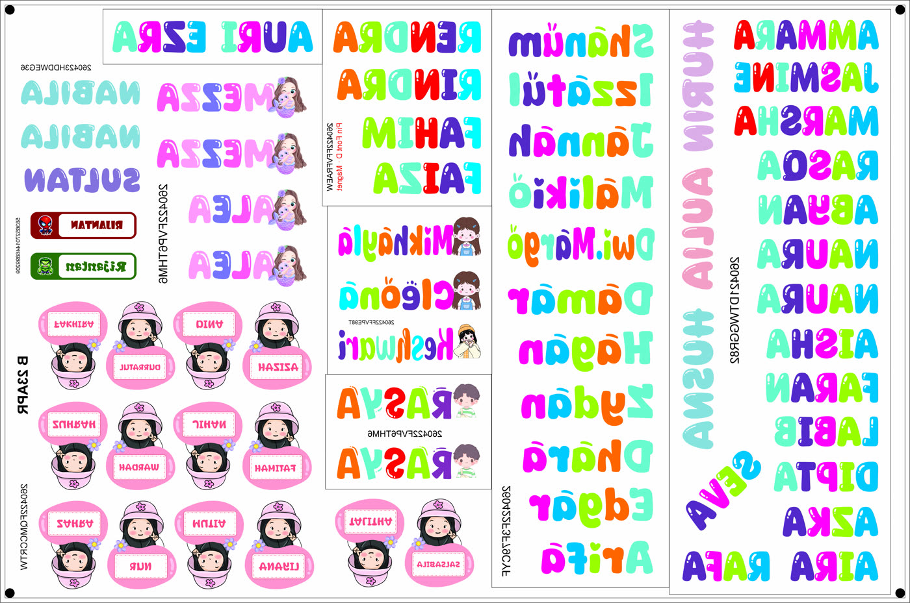

# PRD — Keychain Generator v2

Dokumen ini menjelaskan tujuan produk, siapa yang memakai, alur kerja, dan status fitur. Sumbernya adalah kode di `main` (commit `2cdd700`, tag `nesting-v1-stable`) ditambah isi branch `feature/nesting-v2` dan `feature/nesting-v3-compact` yang belum masuk `main`. Tanggal audit: 10 November 2026.

## Tujuan produk

Tim produksi Kedai Creative butuh cara cepat untuk mengubah pesanan gantungan kunci akrilik menjadi file yang siap dipotong laser dan dicetak. Satu resi bisa berisi banyak nama. Setiap nama punya bentuk potong yang berbeda karena teks dan gambarnya berbeda. Menyusun bentuk itu di lembar akrilik secara manual lambat dan boros bahan.

Aplikasi ini membantu tiga hal:

1. Menyimpan template desain dan pesanan (resi, nama, varian ganci atau pin).
2. Menyusun (nesting) potongan ke lembar akrilik 310×470 mm.
3. Mengunci lembar itu menjadi batch, lalu mengunduh DXF untuk laser dan JPG untuk printer.

Modul kedua, Bahan Mahar, membuat plakat mahar pernikahan dengan alur yang sama secara garis besar, tetapi tabel, API, dan halamannya terpisah.

## Konteks bisnis

Ini konteks dari pemilik, bukan dari kode. Bisnisnya souvenir custom di Shopee dan TikTok Shop. Merek yang disebut: kedaicreative, BKC Trophy, Masterganci, Pehapik, Meera Living, Asikie, dan Griya Unik. Tim memakai BigSeller untuk operasional marketplace dan Accurate untuk pembukuan.

Di dalam kode, yang terlihat hanya nama **Kedai Creative** pada sidebar dan logo. Tidak ada sambungan ke Shopee, TikTok Shop, BigSeller, atau Accurate. Nomor resi diketik sendiri.

## Pengguna

Satu jenis pengguna: operator internal di komputer produksi. Tidak ada akun, peran admin, atau peran operator. Siapa pun yang bisa membuka alamat aplikasi bisa melihat nama pelanggan dan mengubah data.

Pengguna tipikal:

- Admin yang memasukkan template dan pesanan dari resi marketplace.
- Operator yang memilih pesanan, menyusun lembar, mengunci batch, lalu mengunduh file ke mesin laser dan printer (alur cetak yang disebut di kode: Xerox C70, cetak di belakang akrilik).

## Alur kerja pesanan

Alur yang benar-benar ada di aplikasi hari ini:

1. **Template.** Admin mengunggah font (TTF/OTF) dan, untuk template karakter, gambar SVG atau PNG. Admin mengatur warna, tinggi potong, jarak teks, dan apakah ada lubang gantungan. Template bisa mode dinamis (garis potong dihitung aplikasi) atau mode tetap (garis potong sudah ada di SVG).
2. **Input pesanan.** Operator mengetik nomor resi, kode manual jika ada, memilih template, dan menempel daftar nama. Jumlah pesanan sama dengan jumlah nama. Varian: gantungan kunci atau pin. Status awal: pending.
3. **Antrean.** Satu baris per nama. Operator memilih nama yang akan disusun, lalu mengirim ke mesin nesting. Bisa juga menambahkan nama pending ke lembar yang sudah ada.
4. **Staging.** Aplikasi menyimpan posisi tiap potongan di lembar. Operator melihat pratinjau, menghitung HPP kasar (modal lembar dibagi jumlah pcs, tersimpan di browser), lalu mengunci lembar menjadi batch. Ada juga tombol tandai selesai dan bongkar lembar.
5. **File siap cetak.** Batch yang terkunci bisa diunduh sebagai DXF (garis potong, lubang, border, fiducial) dan JPG 300 DPI (gambar cetak, dicerminkan karena cetak dari belakang). Menghapus batch hanya menghapus arsip file. Pesanan tetap berstatus selesai.

Status pesanan di `main`: `pending` → `processing` (setelah masuk lembar) → `completed` (setelah lembar dikunci atau ditandai selesai). Status ini milik seluruh resi, bukan per nama.

Modul mahar: input nama pengantin, tanggal, nominal teks, bentuk, dan ukuran. Nesting mahar dihitung di browser. Hanya hasil yang dikunci yang disimpan ke server.

### Yang berubah di branch nesting-v3-compact

**Ada di branch, belum di main.**

- Antrean punya tiga mode: Production Nesting (bawaan), Legacy Flat (mesin `main`), dan pratinjau Grouped V2 (tidak menulis ke database).
- Mode produksi menolak resi yang sudah ada di lembar kerja, supaya satu resi tidak tercetak dua kali (perbaikan kasus PAT).
- Satu resi disusun sebagai satu kelompok dan tidak dipecah ke banyak lembar.
- Label resi produksi diletakkan di ruang kosong di dalam kelompok, setelah posisi potongan selesai. Label tidak menggeser potongan.
- Mengunci batch dicek ulang ke database. Layout dari browser yang tidak cocok ditolak.
- Lembar produksi bisa memakai tinggi aktif yang lebih pendek dari 470 mm jika isi lembar tidak penuh, supaya bahan tidak terbuang. Ekspor mengikuti bingkai itu.

## Daftar fitur dan status

Status di kolom “Main” adalah yang ada di branch `main` hari ini. Kolom “Branch” hanya diisi jika perilaku di `feature/nesting-v3-compact` berbeda.

| Fitur | Main | Branch nesting-v3-compact |
| --- | --- | --- |
| Dashboard jumlah menunggu, diproses, dan batch | Ada. Angka “menunggu/diproses” menghitung baris item, bukan jumlah resi | Sama |
| Master template karakter dan font | Ada. Mode dinamis dan tetap, warna, lubang, offset huruf, sampul katalog | Sama |
| Input pesanan manual | Ada | Sama |
| Edit pesanan | Tombol ada, tetapi hanya pesan “segera hadir” | Sama |
| Hapus resi | Ada, termasuk resi yang sedang diproses. Item di lembar ikut terhapus | Sama |
| Antrean per nama, filter resi, pilih sekelompok | Ada | Ada, plus pemilih mode nesting |
| Override lubang per nama | Ada, hanya selagi pending | Sama |
| Nesting legacy (MaxRects, semua nama dicampur) | Ada. Ini satu-satunya mesin di main | Masih ada sebagai Legacy Flat |
| Nesting per resi (Grouped V2) | Tidak ada | Ada di branch, belum di main. Pratinjau saja, tidak menyimpan lembar |
| Production Nesting (rapat, satu resi satu lembar) | Tidak ada | Ada di branch, belum di main. Ini bawaan antrean |
| Panel eksperimen (slot, compound, region, benchmark) | Tidak ada | Ada di branch, belum di main. Hanya di mode pratinjau |
| Tambah ke lembar yang sudah ada | Ada, hanya pesanan pending, tidak mengacak isi lama | Ada. Lembar produksi tidak boleh ditambah dengan cara legacy |
| Pratinjau staging dan HPP sederhana | Ada | Ada, plus metrik lembar |
| Kunci batch produksi | Ada. Isi layout dipercaya dari browser | Ada di branch, belum di main: layout dicocokkan ke database dan aturan jarak |
| Tandai selesai tanpa membuat file | Ada. Seluruh resi di lembar jadi selesai | Perlu dicek ulang saat digabung; aturan resi utuh sudah lebih ketat |
| Bongkar lembar | Ada. Semua resi di lembar kembali ke pending | Ada |
| File siap cetak, unduh DXF dan JPG | Ada | Ada. Bingkai tinggi aktif untuk lembar produksi |
| Ubah status batch menjadi sudah dicetak / arsip | Tampilan ada, tidak ada tombol atau API | Sama |
| Bahan Mahar (input, nesting, DXF, batch) | Ada, terpisah dari ganci | Sama |
| Login | Tidak ada. Paket `better-auth` terpasang tetapi tidak dipakai | Sama |
| Impor BigSeller / marketplace | Tidak ada | Tidak ada |
| Jurnal Accurate | Tidak ada | Tidak ada |
| Tes otomatis | Tidak ada | Ada di branch, belum di main. 341 tes nesting pada 10 Nov 2026. Sesi kontur 351 lulus. Sesi susunan blok, lalu perbaikan selang-seling dan kontur tokoh: 371 lulus |

## Keputusan nesting

Rofiq sudah memutuskan aturan susun lembar. Empat butir ini mengalahkan kebiasaan kode lama jika keduanya bentrok.

1. Prioritas utama adalah hemat bahan.
2. Item dari resi yang sama harus berdekatan dan menjadi satu kelompok di lembar. Keping resi lain tidak boleh masuk ke tengah kelompok itu.
3. Di dalam dua aturan di atas, kerapatan harus maksimal.
4. Item boleh diputar. Arahnya (0°, 90°, 180°, 270°) dipilih per keping supaya bahan paling hemat. Nama panjang tidak wajib tegak.

Hemat bahan tidak boleh dicapai dengan mencampur resi. Kelompok tetap utuh, lalu ruang di dalam dan di antara kelompok diisi sepadat mungkin.

Rofiq mengunci tiga hal pada 10 November 2026, sesudah melihat susunan blok:

1. Jarak antar garis potong tetap **1 mm** untuk sementara.
2. Tidak ada aturan tetap “nama panjang harus tegak”.
3. Luas cetak **31 × 47 cm** (310 × 470 mm).

Setelan bawaan tetap tinggi luar 2,6 cm (nama) dan 2,9 cm (tokoh), sudah termasuk kontur. Pembanding dengan foto memakai skala foto: tinta huruf sekitar 1,6 cm, tinggi luar 2,1 cm. Pada skala itu 63 keping muat satu lembar setinggi 438 mm. Foto mengisi satu lembar penuh (470 mm). Rinciannya di [docs/nesting/PENGUKURAN.md](nesting/PENGUKURAN.md).

Patokan gambarnya ada di repo: [docs/reference/contoh-nesting-manual.jpg](reference/contoh-nesting-manual.jpg). Itu penataan manual tim Rofiq. Hasil mesin nanti dibandingkan dengan gambar ini, bukan dengan pratinjau lama.

Yang terlihat pada contoh, dan karena itu menjadi bagian dari keputusan:

- Satu resi = satu blok berbingkai tipis. Di dalam bingkai hanya keping resi itu.
- Kode resi tercetak sekali, kecil, di samping bingkai (sering tegak mengikuti tepi blok). Contoh yang terbaca di gambar: `260423FVP8THM6`. Bukan satu kode di bawah setiap keping.
- Di foto, sebagian nama panjang bertumpuk dan sebagian berbaris. Itu bukan aturan tetap. Arah dipilih supaya bahan paling hemat. Karakter yang se-resi tetap di blok yang sama.
- Keping diputar 90 derajat atau 180 derajat kalau itu membuat blok lebih rapat atau kolomnya sejajar.
- Blok-blok resi disusun memenuhi lembar. Sisa bahan di tepi tipis.
- Empat tanda registrasi (bulatan) ada di empat sudut lembar.
- Sebagian teks tampak terbalik kiri-kanan. Itu sesuai file cetak dari belakang akrilik, bukan susunan yang salah.

### Dukungan kode hari ini

| Aturan | `main` | `feature/nesting-v3-compact` (belum di main) |
| --- | --- | --- |
| Kelompok per resi | Tidak. Packer hanya melihat kotak. Nomor resi tidak dipakai untuk menaruh keping. Nama dari resi berbeda bisa selang-seling. | Ya, pada mode Production. Isi satu resi disusun dulu, lalu kotak kelompok itu ditaruh di lembar. Mode Legacy di antrean branch masih berperilaku seperti `main`. `feature/nesting-v2` sudah mengelompokkan, tetapi hanya pratinjau dan tidak menyimpan lembar. |
| Item boleh diputar | Ya, 90 derajat, per keping. | Ya, 90 derajat, per keping, saat menyusun isi kelompok. Kotak kelompoknya sendiri tidak diputar. Sudut selain 90 derajat tidak ada. |
| Hemat bahan dan kerapatan maksimal | Sebagian. Jarak antar kotak 2 mm ke kanan dan 5 mm ke bawah. Bentuk tidak beraturan (karakter plus nama) menyisakan sudut kosong. | Lebih rapat antar kotak (2 mm di dalam resi dan 2 mm antar resi), dan susunan yang dipilih mengutamakan sisa lembar di bawah yang masih selebar penuh. Tetap kotak pembungkus, bukan garis potong. Lekukan di dalam kelompok tidak terisi. |

### Sesi susunan blok (di atas kontur 2,5 mm, belum di `main`)

Mode produksi sekarang memakai garis potong, bukan hanya kotak. Satu resi = satu blok berbingkai. Kode resi tercetak satu kali, kecil, di kiri bingkai. Keping bisa 0°, 90°, 180°, dan 270°. Bloknya sendiri bisa diputar 90° kalau itu memendekkan lembar. Jarak aman antar garis potong bawaan 1 mm, bisa diubah. Angka dan gambar ada di [docs/nesting/PENGUKURAN.md](nesting/PENGUKURAN.md).

Pada skala foto, 63 keping itu muat satu lembar (438 mm, foto penuh 470 mm). Ukuran lembar 310 × 470 mm sudah dikunci. Jarak 1 mm belum dicek di akrilik.

Contoh manual tidak membutuhkan sudut selain kelipatan 90°. 180° dipakai kalau takik keping bisa saling masuk. 270° sama dengan 90° lalu dibalik, dan hanya dipilih kalau bloknya jadi lebih pendek.

### Celah terhadap keputusan

1. Di `main` keputusan kelompok belum terpenuhi sama sekali. Perbaikan kotak ada di branch nesting lama. Bingkai, label di samping, putaran 180°, dan rapatan garis potong ada di sesi susunan blok, belum di `main`.
2. Resi yang lebih besar dari satu lembar tetap ditolak, tidak dipecah. Contoh manual yang terlihat muat dalam satu lembar. Belum ada keputusan untuk resi yang tidak muat.
3. Jarak 1 mm belum dicek pada akrilik sungguhan. Ukuran lembar 310 × 470 mm sudah dikunci.

## Pertanyaan yang masih terbuka

Yang belum diputuskan ada di bagian nesting. Jawaban kontur sudah ditulis di bawah.

### Nesting

1. Ukuran lembar **310 × 470 mm** sudah dikonfirmasi Rofiq (31 × 47 cm).
2. Jarak aman antar garis potong **1 mm** untuk sementara. Belum dicek pada potongan sungguhan. Mesin kotak lama tetap 2 mm antar kotak.
3. Resi yang tidak muat dalam satu lembar: sesi ini tetap menolak, tidak memecah. Belum ada keputusan baru.
4. Berapa lama operator masih mau menunggu untuk satu gelombang (misalnya 30 nama, atau batch sebesar PAT 228)?
5. Label: satu kode per blok, di samping bingkai. Bukan satu kode di bawah setiap keping. Ini yang tergambar di contoh manual, dan yang sekarang dicetak.

### Garis potong (kontur)

Rofiq menjawab pada 10 November 2026. Angkanya ada di `lib/keychain-geometry.ts`. Ukurannya ada di [docs/contour/PENGUKURAN.md](contour/PENGUKURAN.md).

1. Jarak garis potong dari tepi desain = **2,5 mm** (`OUTLINE_OFFSET_MM`). Itu Contour CorelDRAW ke luar, 1 langkah, offset **0,25 cm**. Angka 0,25 mm yang sempat ditulis adalah salah satuan. Pada sampel, median terukur 2,50 mm. Sudut cembung jadi busur bulat dengan jari-jari 2,5 mm (round join).
2. Celah kecil antar huruf yang lebih sempit dari 5 mm menyatu karena offset 2,5 mm. Lekukan luar yang lebih lebar (gelombang di atas F–a–z–a dan di bawah huruf) tetap mengikuti bentuk huruf. Hanya takik runcing yang sempit, yang rawan patah, yang dibulatkan. Ambang bawaan `GAP_CLOSE_MM` = **2 mm** (radius 1 mm). Closing 4 mm sempat dicoba dan membuat siluet terlalu halus. Closing dijalankan per keping sesudah offset, jadi pinggiran luar tetap 2,5 mm dan spasi kata yang sudah terpisah tetap terbuka. Angka ini bisa diubah di `lib/keychain-geometry.ts`.
3. Lubang dalam huruf (tengah O) dan mata gambar tetap tidak dipotong. Lubang dalam yang kecil pada siluet luar tertutup oleh offset 2,5 mm. Yang ditutup adalah celah, bukan garis potong di dalam huruf.
4. Foto PNG tanpa vektor tetap menjadi kotak. Layar template sekarang memperingatkan “bukan vektor”.
5. Kurva diratakan dengan simpangan paling besar 0,01 mm supaya busur tidak terlihat patah saat diperbesar. Lubang gantungan 1,9 mm di file DXF ditulis sebagai lingkaran, bukan segi 16.
6. Patokan visual: screenshot Corel Rofiq untuk kata “Faza”. Perbandingan run #2, run #3, dan hasil sekarang (font Noto Serif Display Bold Italic, karena Cooper/Bookman tidak ada di mesin) ada di [docs/contour/images/faza-aplikasi.png](contour/images/faza-aplikasi.png). Tabel angka di [docs/contour/PENGUKURAN.md](contour/PENGUKURAN.md).

Yang masih terbuka pada nesting: ukuran lembar, apakah 1 mm cukup di akrilik, resi yang tidak muat, dan lama tunggu. Patokan susunan lembar tetap file contoh manual.

## Masalah terbuka

Masalah yang masih mengganggu pekerjaan, baik di `main` maupun yang baru selesai di branch. Dua keluhan pemilik ada di urutan pertama. Rincian algoritmanya ada di `docs/AUDIT.md`.

1. **Hasil nesting.** `main` masih mencampur resi. Sesi susunan blok (belum di `main`) sudah mengelompokkan, membingkai, menaruh satu kode di samping, memutar 90° dan 180°, dan merapatkan garis potong. Pada sampel 11 resi, tinggi bahan 12,4% lebih pendek dari susunan tangan. Belum dicek pada akrilik. Angkanya di [docs/nesting/PENGUKURAN.md](nesting/PENGUKURAN.md).
2. **Garis potong terlalu kasar — perbaikan ada di branch sesi kontur, belum di `main`.** Jarak potong 2,5 mm (Contour Corel 0,25 cm), sambungan bulat, celah antar huruf di bawah 5 mm tertutup oleh offset itu, kurva diratakan pada 0,01 mm, lubang gantungan di DXF berupa lingkaran. Belum dicek pada potongan akrilik sungguhan. `main` masih mesin lama (ratakan 0,05 mm, lubang segi 16).
3. **Satu resi bisa masuk dua lembar** di `main`. Antrean masih bisa mengirim nama yang statusnya sudah “diproses”. Perbaikan ada di branch, belum di main.
4. **Mengunci satu lembar menandai seluruh resi selesai.** Nama yang tidak ikut terpilih hilang dari antrean. Di mode produksi branch, resi yang sudah tidak pending tidak bisa dikirim lagi, jadi sisa nama itu tidak punya jalan kembali.
5. **Tombol “Mulai Susun Lembar Kerja” di Staging Area tidak bisa jalan.** Ia memanggil API tanpa daftar nama. Penyusunan yang benar dimulai dari Antrean Pesanan.
6. **Membongkar satu lembar mengembalikan semua resi di lembar itu ke pending**, walaupun bagian resi yang sama masih duduk di lembar lain.
7. **Tidak ada login.** Nama pelanggan dan file produksi terbuka bagi siapa saja yang kebuka aplikasinya.
8. **Edit pesanan belum ada.**
9. **Status “Sudah Dicetak” di File Siap Cetak tidak pernah berubah** dari pending.
10. **Tidak ada impor dari BigSeller** dan tidak ada kiriman ke Accurate. Semua resi diketik ulang.
11. **Database satu file SQLite** di komputer yang menjalankan aplikasi. Tidak ada cadangan bawaan. Tidak aman untuk dua server sekaligus.
12. **Dokumentasi lama** hanya `README.md` bawaan Create Next App, plus `CLAUDE.md` yang menunjuk ke `AGENTS.md`. Dokumen ini menggantikan peran dokumen produk. `README.md` sengaja tidak dihapus.

## Di luar produk hari ini

Hal berikut bukan bagian aplikasi sekarang dan tidak boleh dianggap sudah ada:

- Sinkron pesanan Shopee atau TikTok Shop.
- Akun banyak orang dengan hak berbeda.
- Nesting bentuk asli (bukan kotak) belum ada. Itu celah kerapatan di keputusan nesting, dikerjakan di roadmap P0.5, bukan fitur terpisah di luar produk.
- Harga jual, ongkir, atau stok bahan yang terhubung ke Accurate.
