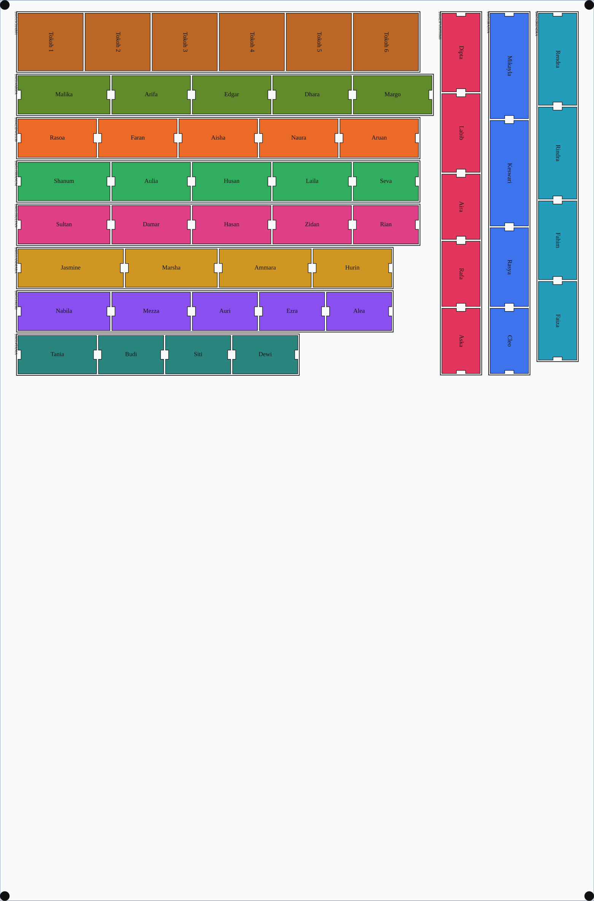

# Pengukuran susunan lembar — sebelum dan sesudah

Tanggal: 10 November 2026. Mesin baru ada di atas kontur 2,5 mm. Belum digabung ke `main`.

Patokan gambar: [contoh penataan manual](../reference/contoh-nesting-manual.jpg).

Sampel meniru isi gambar itu: 10 resi nama (3–10 huruf) ditambah 1 resi tokoh (6 keping). Jumlah keping 52. Ukuran nama: tinggi 20 mm, lebar 6 mm + 7 mm per huruf, paling lebar 80 mm. Tiap nama punya takik kecil di tepi, supaya rapatan garis potong terukur, bukan hanya kotak.

Lembar 310 × 470 mm. Jarak aman antar garis potong bawaan **1 mm** (`CUT_CLEARANCE_MM` di `lib/nesting/shape-block-config.ts`). Bingkai 0,8 mm di luar keping. Kode resi di selokan 2,6 mm di kiri bingkai. Tanda registrasi tetap di empat sudut.

## Angka

Tinggi adalah batas bawah isi (bingkai dan kode ikut terhitung pada mesin baru dan pada susunan tangan). Persen panjang = tinggi ÷ 470. Persen isi = luas kotak keping ÷ (310 × tinggi). Persen isi yang lebih besar berarti lebih rapat. Tinggi yang lebih kecil berarti akrilik yang terpakai lebih pendek.

| Susunan | Lembar | Tinggi | Panjang lembar | Isi |
| --- | --- | --- | --- | --- |
| Sebelum (kotak, mesin lama) | 1 | 205,0 mm | 43,6% | 69,4% |
| Sesudah (garis potong + bingkai) | 1 | 195,8 mm | 41,7% | 72,7% |
| Tangan (kolom nama, seperti contoh) | 1 | 223,6 mm | 47,6% | 63,7% |

Mesin baru memakai **195,8 mm**, yaitu **12,4% lebih pendek** dari susunan tangan (223,6 mm). Batasnya paling boros 10% di atas tangan. Tidak ada resi yang tercampur atau terpecah.

Dibanding kotak lama, tinggi turun dari 205,0 mm ke 195,8 mm (sekitar 4,5%), padahal bingkai dan kode resi sekarang ikut memakan tempat.

Gambar:

- Sebelum: [images/sebelum-kotak.png](images/sebelum-kotak.png)
- Sesudah: [images/sesudah-bentuk.png](images/sesudah-bentuk.png)
- Tangan: [images/susunan-tangan.png](images/susunan-tangan.png)

## Cara mengubah jarak aman

Di `lib/nesting/shape-block-config.ts`:

- `CUT_CLEARANCE_MM` — jarak minimum antar garis potong. Bawaan 1. Naikkan jika hasil potong nyaris bersinggungan.
- `FRAME_PAD_MM` — udara antara keping dan bingkai. Bawaan 0,8.
- `BLOCK_GAP_MM` — jarak antar blok resi. Bawaan 1.
- `LABEL_GUTTER_MM` — tebal selokan kode resi. Bawaan 2,6.

Gambar ulang sampel: `npx tsx scripts/render-nesting-compare.ts`.

## Yang belum dicek di akrilik

Angka di atas dari hitungan, bukan dari lembar yang sudah dipotong. Ukuran lembar tetap 310 × 470 mm. Resi yang lebih besar dari satu lembar tetap ditolak, tidak dipecah.
