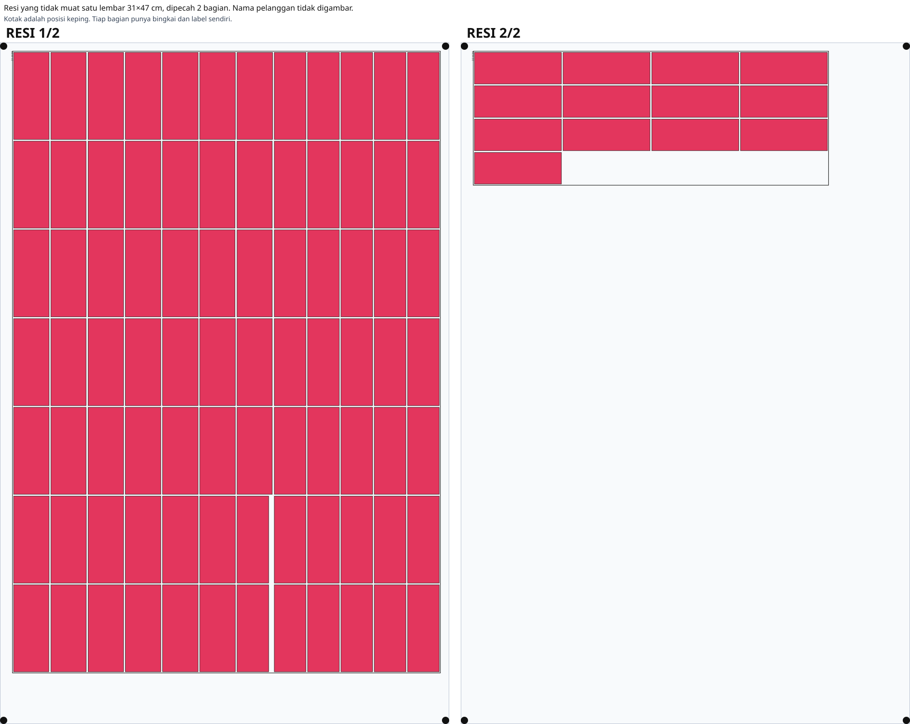
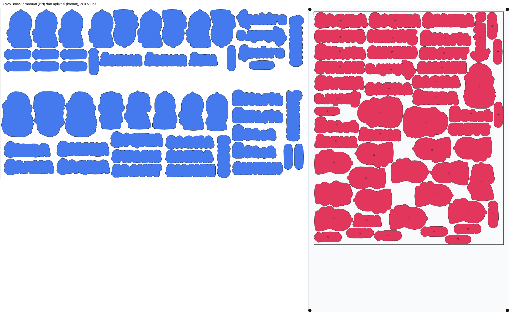
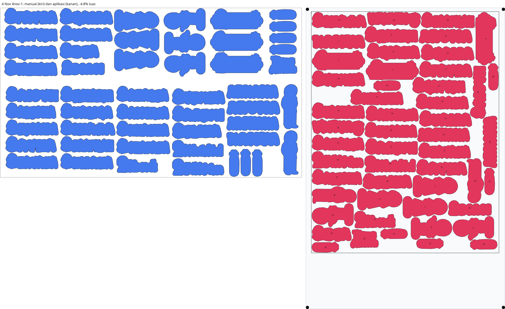
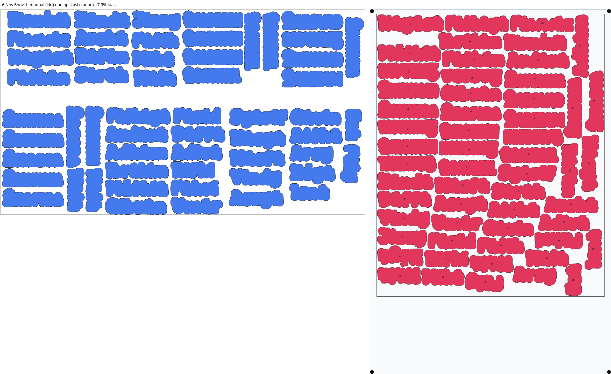
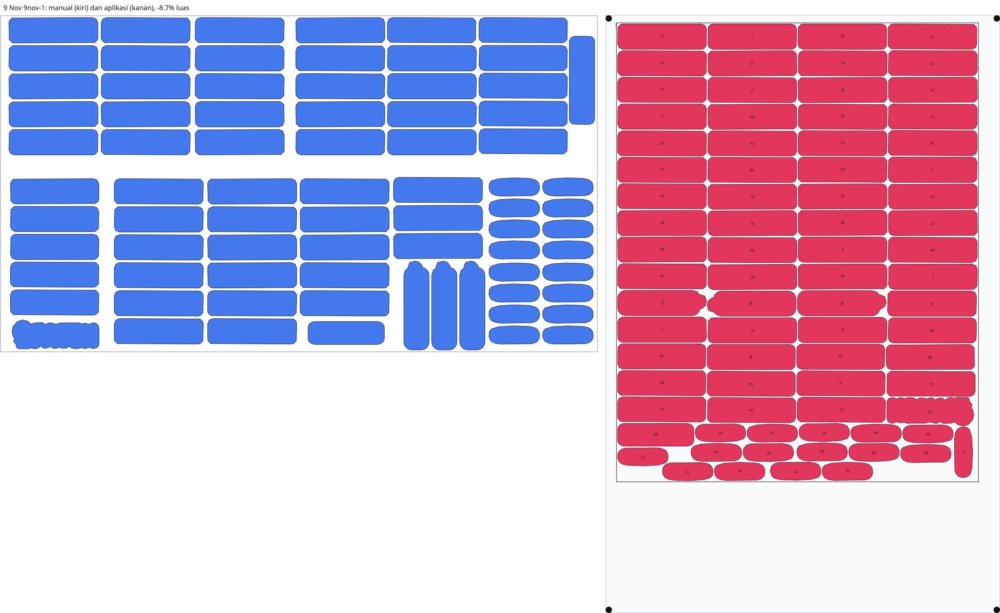
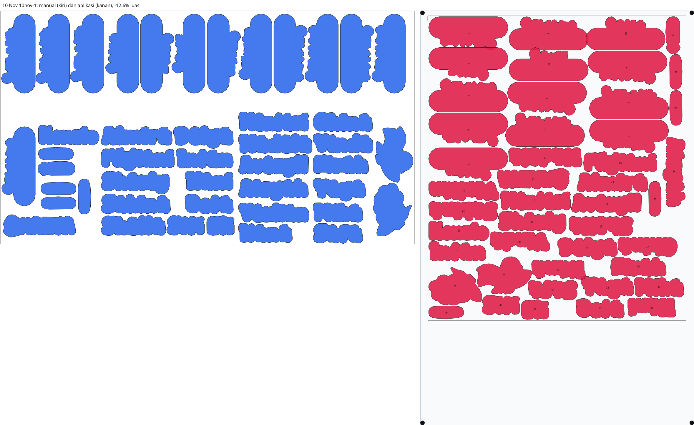
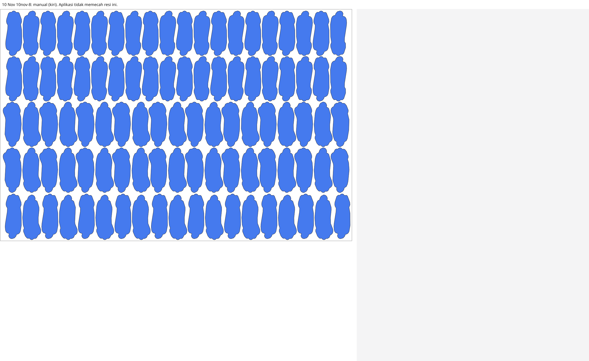
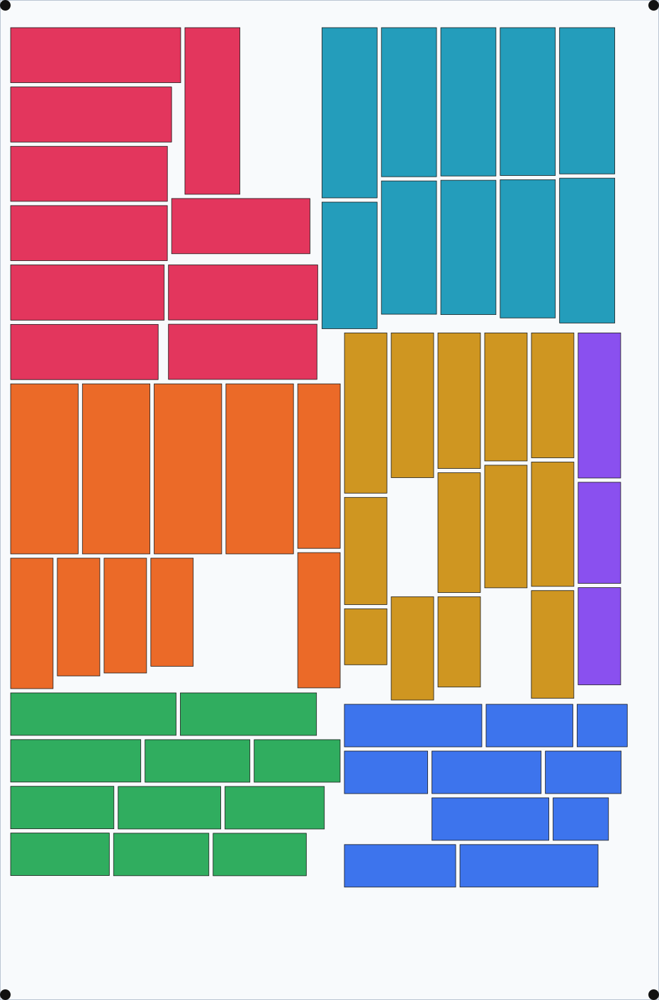
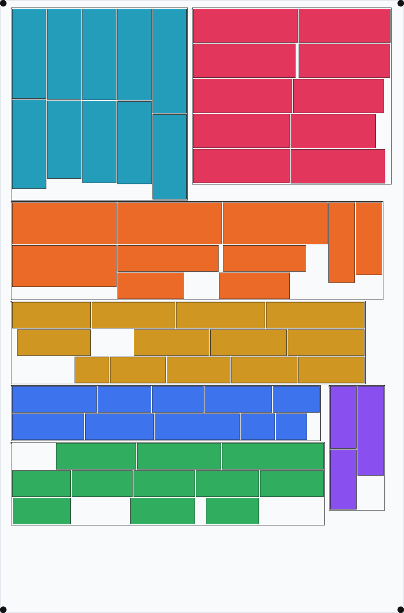

# Pengukuran susunan lembar

Tanggal: 11 November 2026. Belum digabung ke `main`.

Patokan: foto lembar manual Rofiq, [contoh penataan manual](../reference/contoh-nesting-manual.jpg). Foto itu satu lembar penuh 310 × 470 mm.

## Setelan ukuran

Yang diatur adalah **tinggi luar garis potong**, sudah termasuk kontur 2,5 mm di atas dan di bawah. Tinggi hurufnya sendiri lebih pendek 5 mm.

| | Bawaan | Skala foto (pembanding) |
| --- | --- | --- |
| Nama saja | 26 mm (huruf 21 mm) | 21 mm (tinta terukur 16 mm + kontur 5 mm) |
| Tokoh | 29 mm (gambar 24 mm) | 23,4 mm, supaya perbandingannya sama |

Bawaan ada di `NAME_OUTER_MM` dan `CHARACTER_OUTER_MM` pada `lib/nesting/manual-real-outline.ts`. Ukuran ini nanti bisa diubah. Pembanding di bawah memakai skala foto, bukan bawaan 26 mm, supaya kepingnya sama besar dengan foto.

Jarak antar potongan 1 mm. Arah nama tidak dipaksa. Kolom tegak (nama diputar 90° atau 270°, berjajar, selang-seling 180°) ikut dicoba. Yang dipilih adalah bentuk blok yang membuat lembar paling pendek.

## Skala foto

Gambar 1400 × 929 piksel. Sisi panjang = 470 mm, sisi pendek = 310 mm. Di kolom Ammara, tinta huruf sekitar 16 mm, jarak antar baris sekitar 23 mm. Celah putih itu memuat kontur 2,5 mm di tiap sisi, jadi tinggi luar keping di foto sekitar 21 mm.

## Angka pada skala yang sama

63 keping, 7 resi, font Coffee Soda (tidak di-commit), kontur 2,5 mm. Contoh: Ammara 89 × 21 mm.

| Susunan | Lembar | Tinggi isi | Isi |
| --- | --- | --- | --- |
| Foto manual | 1 | 470 mm (penuh) | — |
| Aplikasi | 1 | 437,9 mm | 78,3% dari luas yang terpakai |

Aplikasi **6,8% lebih pendek** dari lembar penuh. Masih satu lembar, di dalam batas 10% lebih boros.

Untuk nama-nama ini, baris horizontal yang sebagian dibalik 180° lebih pendek daripada kolom tegak. Kolom tetap ada di mesin dan menang kalau itu yang lebih hemat, misalnya banyak nama yang tidak muat berjajar kalau tidur.

Gambar skala sama, kiri foto, kanan aplikasi: [images/manual-vs-aplikasi.png](images/manual-vs-aplikasi.png)

## Cara mengulang foto

`npx tsx scripts/measure-manual-real.ts`

## Lembar vektor tim desain

Enam berkas potong (3, 4, 5, 6, 9, dan 10 Nov) berisi 37 lembar fisik. Yang diukur adalah garis potong di vektor, bukan tebakan dari foto. Hampir semua bingkai yang digambar tim berukuran 470 × 265 mm. Satu lembar di 10 Nov berukuran 470 × 310 mm, yaitu lembar 31 × 47 cm yang dipakai tidur.

Kode resi tidak ada di berkas potong (yang ada garis potong dan tanda registrasi), jadi satu bingkai dibanding sebagai satu resi. Keping dari bingkai itu tidak dicampur dengan bingkai lain. Kalau resi itu tidak muat satu lembar, aplikasi memecahnya (10 Nov 8).

Luas manual = luas bingkai yang mereka isi. Luas aplikasi = 310 mm × tinggi yang terpakai di lembar 31 × 47 cm. Angka minus berarti aplikasi lebih hemat.

| Lembar | Keping | Bingkai | Aplikasi | Selisih luas | Isi |
| --- | --- | --- | --- | --- | --- |
| 3 Nov 1 | 52 | 470×265 | 1 lembar, 363 mm | −9,6% | 66,1% |
| 3 Nov 2 | 57 | 470×265 | 1 lembar, 371 mm | −7,8% | 69,4% |
| 3 Nov 3 | 39 | 470×265 | 1 lembar, 409 mm | +1,8% | 66,5% |
| 3 Nov 4 | 68 | 470×265 | 1 lembar, 365 mm | −9,2% | 67,9% |
| 3 Nov 5 | 23 | 470×265 | 1 lembar, 377 mm | −6,2% | 65,9% |
| 4 Nov 1 | 51 | 470×265 | 1 lembar, 381 mm | −5,1% | 64,3% |
| 4 Nov 2 | 63 | 470×265 | 1 lembar, 372 mm | −7,4% | 68,2% |
| 4 Nov 3 | 58 | 470×265 | 1 lembar, 381 mm | −5,2% | 62,9% |
| 4 Nov 4 | 43 | 470×265 | 1 lembar, 353 mm | −12,0% | 64,6% |
| 4 Nov 5 | 58 | 470×265 | 1 lembar, 360 mm | −10,4% | 63,1% |
| 4 Nov 6 | 62 | 470×265 | 1 lembar, 368 mm | −8,4% | 60,3% |
| 5 Nov 1 | 54 | 470×265 | 1 lembar, 398 mm | −0,9% | 63,1% |
| 5 Nov 2 | 65 | 470×265 | 1 lembar, 378 mm | −5,9% | 60,9% |
| 5 Nov 3 | 50 | 470×265 | 1 lembar, 376 mm | −6,3% | 63,5% |
| 5 Nov 4 | 55 | 470×265 | 1 lembar, 391 mm | −2,7% | 64,4% |
| 6 Nov 1 | 56 | 470×265 | 1 lembar, 380 mm | −5,5% | 64,5% |
| 6 Nov 2 | 34 | 470×265 | 1 lembar, 406 mm | +1,0% | 65,7% |
| 6 Nov 3 | 49 | 470×265 | 1 lembar, 390 mm | −3,0% | 72,3% |
| 6 Nov 4 | 54 | 470×265 | 1 lembar, 402 mm | −0,1% | 62,3% |
| 6 Nov 5 | 67 | 470×265 | 1 lembar, 365 mm | −9,2% | 66,2% |
| 9 Nov 1 | 77 | 470×265 | 1 lembar, 369 mm | −8,2% | 79,3% |
| 9 Nov 2 | 70 | 470×265 | 1 lembar, 411 mm | +2,4% | 63,7% |
| 9 Nov 3 | 53 | 470×265 | 1 lembar, 400 mm | −0,5% | 66,8% |
| 9 Nov 4 | 48 | 470×265 | 1 lembar, 390 mm | −3,0% | 68,0% |
| 9 Nov 5 | 75 | 470×265 | 1 lembar, 379 mm | −5,7% | 63,7% |
| 9 Nov 6 | 65 | 470×265 | 1 lembar, 402 mm | −0,0% | 63,2% |
| 9 Nov 7 | 59 | 470×265 | 1 lembar, 391 mm | −2,6% | 66,3% |
| 9 Nov 8 | 55 | 470×265 | 1 lembar, 370 mm | −8,0% | 67,6% |
| 9 Nov 9 | 29 | 470×265 | 1 lembar, 403 mm | +0,3% | 61,0% |
| 10 Nov 1 | 45 | 470×265 | 1 lembar, 362 mm | −9,9% | 64,5% |
| 10 Nov 2 | 61 | 470×265 | 1 lembar, 389 mm | −3,2% | 64,9% |
| 10 Nov 3 | 44 | 470×265 | 1 lembar, 373 mm | −7,2% | 62,5% |
| 10 Nov 4 | 58 | 470×265 | 1 lembar, 381 mm | −5,1% | 61,5% |
| 10 Nov 5 | 63 | 470×265 | 1 lembar, 361 mm | −10,2% | 64,7% |
| 10 Nov 6 | 33 | 470×265 | 1 lembar, 377 mm | −6,2% | 63,3% |
| 10 Nov 7 | 53 | 470×265 | 1 lembar, 405 mm | +0,8% | 61,1% |
| 10 Nov 8 | 97 | 470×310 | 2 lembar, label 1/2 (84 keping, 429 mm) dan 2/2 (13 keping, 92 mm) | — | — |

36 lembar muat di satu lembar aplikasi pada pengukuran sebelum perbaikan jarak potong. Yang terboros di antara yang muat adalah 9 Nov 2, 2,4% lebih luas dari bingkainya. Sebelum putaran selang-seling, yang terboros adalah 9 Nov 9 (+2,8%). Sisanya di bawah batas 10%. Kolom “Isi” adalah luas garis potong dibagi luas 310 mm × tinggi terpakai.

4 Nov 1, sesudah perbaikan jarak garis potong yang ikut dari tombol Staging, tidak muat sebagai satu blok. Aplikasi memecahnya menjadi dua bagian berlabel `1/2` dan `2/2`. Angka satu lembar di tabel adalah ukuran sebelum perbaikan jarak itu.

Ukuran diukur ulang 20 November 2026 setelah mesin boleh membalik keping 180° kalau itu tidak membuat blok lebih tinggi, dan mengisi celah yang masih muat. 10 Nov 8 tetap tidak muat sebagai satu blok.

10 Nov 8 adalah lembar penuh: 97 tag sekitar 22–24 × 60 mm mengisi 470 × 310 mm sampai dekat tepi. Margin kamera 6 mm, bingkai, dan label menyisakan daerah yang tidak cukup untuk 97 keping itu. Keputusan Rofiq (fitur C): resi ini dipecah. Hasilnya dua blok berbingkai, label `10 Nov 8 1/2` (84 keping, jejak 298×429 mm) dan `10 Nov 8 2/2` (13 keping, jejak 248×92 mm). Resi yang masih muat satu lembar tidak dipecah. Gambar di bawah memakai kotak, bukan garis huruf, supaya nama pelanggan tidak terbaca.

Contoh, kiri susunan manual, kanan aplikasi. Skala milimeter sama. 4 Nov memuat tokoh besar dan tag; 9 Nov rapat dan seragam. 10 Nov 8 yang dipecah ada di gambar terpisah di atas, tanpa nama pelanggan.

Garis potong yang dibandingkan ada di `lib/nesting/fixtures/manual-vector-sheets.json` (2.043 keping). Berkas `.ai` mentah tidak disimpan.

`npx tsx scripts/measure-vector-sheets.ts`

## Lembar 67 keping (snapshot 20 November)

Di berkas yang Rofiq coba, label di layar mengikuti nomor lembar di database.

- Lembar Kerja #3 berisi 67 keping dan 7 resi. Statusnya INVALID.
- Lembar Kerja #5 berisi 62 keping. Pemeriksaan jarak, batas lembar, dan resi utuh lolos. Nomor 67 dan nomor 5 bukan lembar yang sama. Font tidak ada di snapshot, jadi selisih ukuran kontur baru tidak diukur di sini. Di komputer yang punya font, keping yang ukurannya berubah lebih dari 0,01 mm ikut INVALID, dengan pesan untuk bongkar dan susun ulang.

Tiga resi utuh ada di lembar #2 (tersusun 25 Oktober 2026, pukul 04:50) dan tersusun lagi di lembar #3 dua menit kemudian. Jumlah nama pada pesanan sama dengan jumlah keping di masing-masing lembar, jadi ini cetak dobel, bukan sisa nama yang terpecah. Itulah pesan INVALID. Kiriman kedua sekarang ditolak sebelum disimpan. Cara membereskan data lama: bongkar lembar yang dobel, lalu kirim ulang resi itu satu kali dari Antrean.

Gambar di bawah memakai kotak pembungkus keping yang tersimpan. Font dan SVG tidak ada di snapshot, jadi garis hurufnya tidak digambar ulang, dan tidak ada nama atau nomor resi.

| | Keping | Lembar | Tinggi | Isi dari tinggi terpakai | Isi dari lembar 310×470 |
| --- | --- | --- | --- | --- | --- |
| Tersimpan (Oktober) | 67 | 1 | 416,9 mm | 71,1% | 63,0% |
| Susunan baru | 67 | 1 | 402,6 mm | 73,6% | 63,0% |

Susunan baru lebih pendek 14,3 mm. Arah keping: 21 pada 0°, 13 pada 90°, 31 pada 180°, 2 pada 270°. Celah yang tersisa lebih sempit daripada keping yang masih ada, jadi tidak bisa diisi tanpa melanggar jarak 1 mm.

`npx tsx scripts/measure-lembar67.ts`
