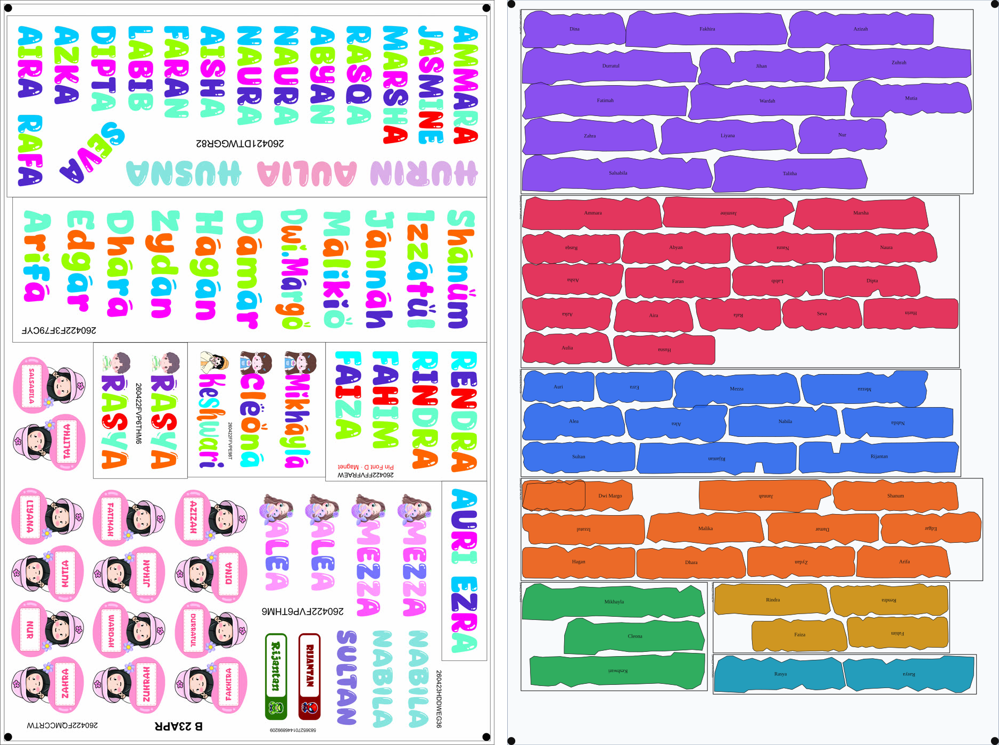

# Pengukuran susunan lembar

Tanggal: 11 November 2026. Belum digabung ke `main`.

Patokan: foto lembar manual Rofiq, [contoh penataan manual](../reference/contoh-nesting-manual.jpg). Foto itu satu lembar penuh 310 × 470 mm.

## Setelan ukuran

Yang diatur adalah **tinggi luar garis potong**, sudah termasuk kontur 2,5 mm di atas dan di bawah. Tinggi hurufnya sendiri lebih pendek 5 mm.

| | Bawaan | Skala foto (pembanding) |
| --- | --- | --- |
| Nama saja | 26 mm (huruf 21 mm) | 21 mm (tinta terukur 16 mm + kontur 5 mm) |
| Tokoh | 29 mm (gambar 24 mm) | 23,4 mm, supaya perbandingannya sama |

Bawaan ada di `NAME_OUTER_MM` dan `CHARACTER_OUTER_MM` pada `lib/nesting/manual-real-outline.ts`. Ukuran ini nanti bisa diubah. Pembanding di bawah memakai skala foto, bukan bawaan 26 mm, supaya kepingnya sama besar dengan foto.

Jarak antar potongan 1 mm. Arah nama tidak dipaksa. Kolom tegak (nama diputar 90° atau 270°, berjajar, selang-seling 180°) ikut dicoba. Yang dipilih adalah bentuk blok yang membuat lembar paling pendek.

## Skala foto

Gambar 1400 × 929 piksel. Sisi panjang = 470 mm, sisi pendek = 310 mm. Di kolom Ammara, tinta huruf sekitar 16 mm, jarak antar baris sekitar 23 mm. Celah putih itu memuat kontur 2,5 mm di tiap sisi, jadi tinggi luar keping di foto sekitar 21 mm.

## Angka pada skala yang sama

63 keping, 7 resi, font Coffee Soda (tidak di-commit), kontur 2,5 mm. Contoh: Ammara 89 × 21 mm.

| Susunan | Lembar | Tinggi isi | Isi |
| --- | --- | --- | --- |
| Foto manual | 1 | 470 mm (penuh) | — |
| Aplikasi | 1 | 437,9 mm | 78,3% dari luas yang terpakai |

Aplikasi **6,8% lebih pendek** dari lembar penuh. Masih satu lembar, di dalam batas 10% lebih boros.

Untuk nama-nama ini, baris horizontal yang sebagian dibalik 180° lebih pendek daripada kolom tegak. Kolom tetap ada di mesin dan menang kalau itu yang lebih hemat, misalnya banyak nama yang tidak muat berjajar kalau tidur.

Gambar skala sama, kiri foto, kanan aplikasi: [images/manual-vs-aplikasi.png](images/manual-vs-aplikasi.png)

## Cara mengulang

`npx tsx scripts/measure-manual-real.ts`
