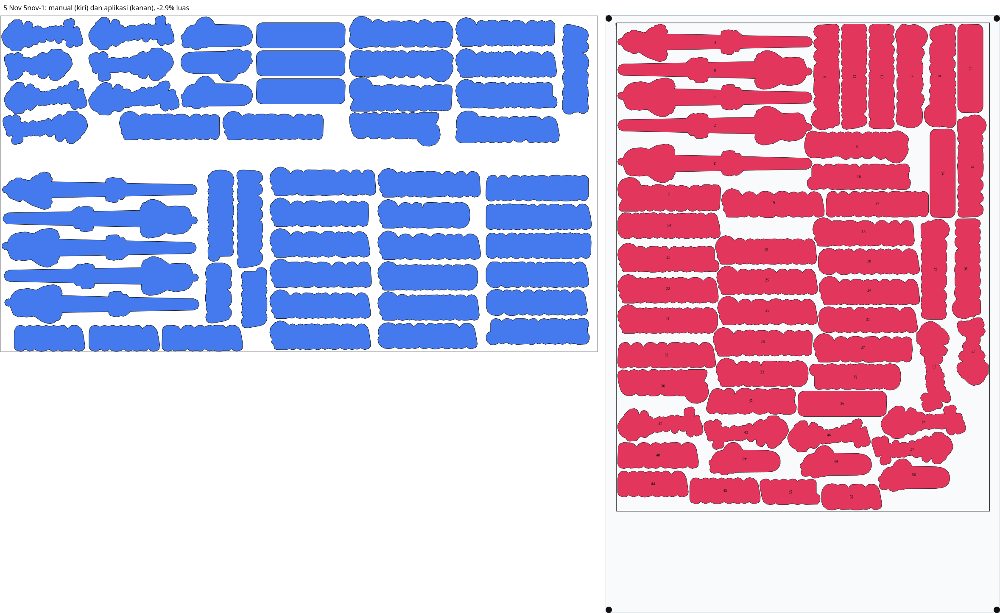

# Pengukuran susunan lembar

Tanggal: 11 November 2026. Belum digabung ke `main`.

Patokan: foto lembar manual Rofiq, [contoh penataan manual](../reference/contoh-nesting-manual.jpg). Foto itu satu lembar penuh 310 × 470 mm.

## Setelan ukuran

Yang diatur adalah **tinggi luar garis potong**, sudah termasuk kontur 2,5 mm di atas dan di bawah. Tinggi hurufnya sendiri lebih pendek 5 mm.

| | Bawaan | Skala foto (pembanding) |
| --- | --- | --- |
| Nama saja | 26 mm (huruf 21 mm) | 21 mm (tinta terukur 16 mm + kontur 5 mm) |
| Tokoh | 29 mm (gambar 24 mm) | 23,4 mm, supaya perbandingannya sama |

Bawaan ada di `NAME_OUTER_MM` dan `CHARACTER_OUTER_MM` pada `lib/nesting/manual-real-outline.ts`. Ukuran ini nanti bisa diubah. Pembanding di bawah memakai skala foto, bukan bawaan 26 mm, supaya kepingnya sama besar dengan foto.

Jarak antar potongan 1 mm. Arah nama tidak dipaksa. Kolom tegak (nama diputar 90° atau 270°, berjajar, selang-seling 180°) ikut dicoba. Yang dipilih adalah bentuk blok yang membuat lembar paling pendek.

## Skala foto

Gambar 1400 × 929 piksel. Sisi panjang = 470 mm, sisi pendek = 310 mm. Di kolom Ammara, tinta huruf sekitar 16 mm, jarak antar baris sekitar 23 mm. Celah putih itu memuat kontur 2,5 mm di tiap sisi, jadi tinggi luar keping di foto sekitar 21 mm.

## Angka pada skala yang sama

63 keping, 7 resi, font Coffee Soda (tidak di-commit), kontur 2,5 mm. Contoh: Ammara 89 × 21 mm.

| Susunan | Lembar | Tinggi isi | Isi |
| --- | --- | --- | --- |
| Foto manual | 1 | 470 mm (penuh) | — |
| Aplikasi | 1 | 437,9 mm | 78,3% dari luas yang terpakai |

Aplikasi **6,8% lebih pendek** dari lembar penuh. Masih satu lembar, di dalam batas 10% lebih boros.

Untuk nama-nama ini, baris horizontal yang sebagian dibalik 180° lebih pendek daripada kolom tegak. Kolom tetap ada di mesin dan menang kalau itu yang lebih hemat, misalnya banyak nama yang tidak muat berjajar kalau tidur.

Gambar skala sama, kiri foto, kanan aplikasi: [images/manual-vs-aplikasi.png](images/manual-vs-aplikasi.png)

## Cara mengulang foto

`npx tsx scripts/measure-manual-real.ts`

## Lembar vektor tim desain

Enam berkas potong (3, 4, 5, 6, 9, dan 10 Nov) berisi 37 lembar fisik. Yang diukur adalah garis potong di vektor, bukan tebakan dari foto. Hampir semua bingkai yang digambar tim berukuran 470 × 265 mm. Satu lembar di 10 Nov berukuran 470 × 310 mm, yaitu lembar 31 × 47 cm yang dipakai tidur.

Kode resi tidak ada di berkas potong (yang ada garis potong dan tanda registrasi), jadi satu bingkai dibanding sebagai satu resi. Keping dari bingkai itu tidak dicampur dengan bingkai lain, dan tidak dipecah.

Luas manual = luas bingkai yang mereka isi. Luas aplikasi = 310 mm × tinggi yang terpakai di lembar 31 × 47 cm. Angka minus berarti aplikasi lebih hemat.

| Lembar | Keping | Bingkai | Aplikasi | Selisih luas |
| --- | --- | --- | --- | --- |
| 3 Nov 1 | 52 | 470×265 | 1 lembar, 366 mm | −9,0% |
| 3 Nov 2 | 57 | 470×265 | 1 lembar, 392 mm | −2,5% |
| 3 Nov 3 | 39 | 470×265 | 1 lembar, 397 mm | −1,1% |
| 3 Nov 4 | 68 | 470×265 | 1 lembar, 369 mm | −8,0% |
| 3 Nov 5 | 23 | 470×265 | 1 lembar, 371 mm | −7,6% |
| 4 Nov 1 | 51 | 470×265 | 1 lembar, 383 mm | −4,8% |
| 4 Nov 2 | 63 | 470×265 | 1 lembar, 371 mm | −7,7% |
| 4 Nov 3 | 58 | 470×265 | 1 lembar, 390 mm | −2,9% |
| 4 Nov 4 | 43 | 470×265 | 1 lembar, 347 mm | −13,6% |
| 4 Nov 5 | 58 | 470×265 | 1 lembar, 361 mm | −10,1% |
| 4 Nov 6 | 62 | 470×265 | 1 lembar, 372 mm | −7,5% |
| 5 Nov 1 | 54 | 470×265 | 1 lembar, 390 mm | −2,9% |
| 5 Nov 2 | 65 | 470×265 | 1 lembar, 375 mm | −6,6% |
| 5 Nov 3 | 50 | 470×265 | 1 lembar, 373 mm | −7,3% |
| 5 Nov 4 | 55 | 470×265 | 1 lembar, 393 mm | −2,3% |
| 6 Nov 1 | 56 | 470×265 | 1 lembar, 370 mm | −7,9% |
| 6 Nov 2 | 34 | 470×265 | 1 lembar, 407 mm | +1,4% |
| 6 Nov 3 | 49 | 470×265 | 1 lembar, 390 mm | −3,0% |
| 6 Nov 4 | 54 | 470×265 | 1 lembar, 397 mm | −1,3% |
| 6 Nov 5 | 67 | 470×265 | 1 lembar, 380 mm | −5,3% |
| 9 Nov 1 | 77 | 470×265 | 1 lembar, 367 mm | −8,7% |
| 9 Nov 2 | 70 | 470×265 | 1 lembar, 405 mm | +0,9% |
| 9 Nov 3 | 53 | 470×265 | 1 lembar, 404 mm | +0,5% |
| 9 Nov 4 | 48 | 470×265 | 1 lembar, 397 mm | −1,1% |
| 9 Nov 5 | 75 | 470×265 | 1 lembar, 352 mm | −12,4% |
| 9 Nov 6 | 65 | 470×265 | 1 lembar, 401 mm | −0,2% |
| 9 Nov 7 | 59 | 470×265 | 1 lembar, 402 mm | −0,0% |
| 9 Nov 8 | 55 | 470×265 | 1 lembar, 373 mm | −7,2% |
| 9 Nov 9 | 29 | 470×265 | 1 lembar, 413 mm | +2,8% |
| 10 Nov 1 | 45 | 470×265 | 1 lembar, 351 mm | −12,6% |
| 10 Nov 2 | 61 | 470×265 | 1 lembar, 394 mm | −2,0% |
| 10 Nov 3 | 44 | 470×265 | 1 lembar, 364 mm | −9,4% |
| 10 Nov 4 | 58 | 470×265 | 1 lembar, 380 mm | −5,5% |
| 10 Nov 5 | 63 | 470×265 | 1 lembar, 360 mm | −10,4% |
| 10 Nov 6 | 33 | 470×265 | 1 lembar, 393 mm | −2,1% |
| 10 Nov 7 | 53 | 470×265 | 1 lembar, 389 mm | −3,1% |
| 10 Nov 8 | 97 | 470×310 | tidak muat, resi tidak dipecah | — |

36 lembar muat di satu lembar aplikasi. Yang terboros di antara yang muat adalah 9 Nov 9, 2,8% lebih luas dari bingkainya. Sisanya di bawah batas 10%.

10 Nov 8 adalah lembar penuh: 97 tag sekitar 22–24 × 60 mm mengisi 470 × 310 mm sampai dekat tepi. Margin kamera 6 mm, bingkai, dan label menyisakan daerah yang tidak cukup untuk 97 keping itu. Aplikasi tidak memecah resi menjadi dua lembar.

Contoh, kiri susunan manual, kanan aplikasi. Skala milimeter sama. 4 Nov memuat tokoh besar dan tag; 9 Nov rapat dan seragam; 10 Nov 8 hanya sisi manual karena aplikasi menolak memecah.

Garis potong yang dibandingkan ada di `lib/nesting/fixtures/manual-vector-sheets.json` (2.043 keping). Berkas `.ai` mentah tidak disimpan.

`npx tsx scripts/measure-vector-sheets.ts`
